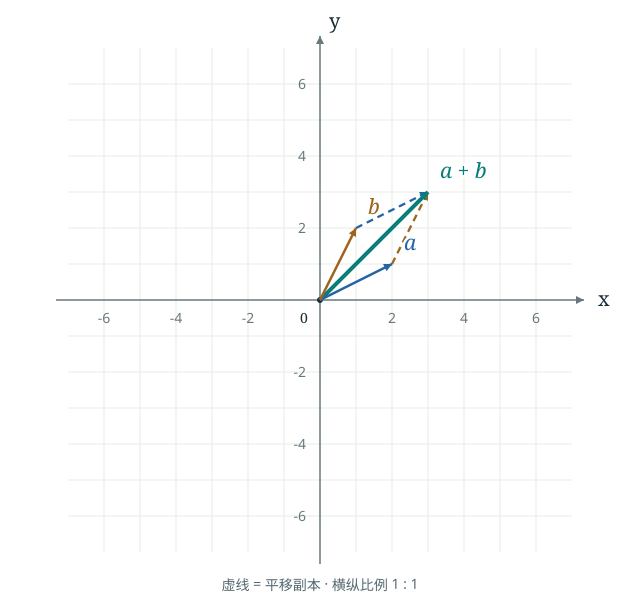

# 实验说明

## Topic · 主题

两个平面向量相加时，为什么“先沿一个向量走，再沿另一个向量走”会到达合向量的终点？

设 $a=(a_x,a_y)$、$b=(b_x,b_y)$，结果为 $s=a+b$。坐标表示相对原点的位移，不是图上箭头必须固定的绝对位置。默认值 $a=(2,1)$、$b=(1,2)$ 由本项目选择；教材定位维护在 `unit.json`，不声称复刻原图数值。

## Mathematical Insight · 几何直觉

把 $b$ 平移到 $a$ 的终点，不改变它的长度、方向和分量。从原点先走 $a$、再走这份 $b$，总位移是 $(a_x+b_x,a_y+b_y)$。绿色合向量连接原点与这个终点。

虚线还展示另一条路径：先走 $b$ 再走 $a$，终点相同。两条路径围成平行四边形，合向量沿其对角线；共线、抵消或零向量时图形会退化，仍满足相同的加法关系。

## Visualization · 可视化

- [静态 SVG](figure.svg)：默认参数插图，可独立查看或嵌入笔记。
- [交互 HTML](interactive.html)：拖动滑块或输入分量，实时比较两条路径与合向量。



文件职责：`model.js` 只计算向量和、标记零向量；`view.js` 生成等比例 SVG；`app.js` 处理输入和更新；`style.css` 为本 Unit 的页面样式。`generate.cjs` 从同一模型、同一绘图函数生成上面的静态图。

在仓库根目录重新生成：

```bash
node visualizations/vector-addition/generate.cjs
```

Node 18+，仅使用标准库，无需 npm 安装。阅读 HTML/SVG 不需要 Node，也无网络运行依赖。目录中的 `interactive.html` 使用 classic scripts，可连同本目录资源复制后离线运行；复制出仓库后“返回目录”链接不适用。

## Usage · 如何观察

1. 先看默认 $a=(2,1)$、$b=(1,2)$：蓝色实线后接棕色虚线，到达 $s=(3,3)$。
2. 对比棕色实线后接蓝色虚线，确认顺序改变而终点不变。虚线表示平移副本，不是额外的新向量。
3. 改变一个分量，观察箭头和读数如何一起变化。分量范围为 $[-3,3]$，步长 $0.5$；两个轴始终采用相同单位长度，视窗固定为约 $[-7,7]$。
4. 点击“相互抵消”：$b=-a$，路径返回原点，合向量为零；点击“含零向量”观察只有一条非零位移。零向量用圆环表示，没有方向。
5. 点击“恢复默认”，或用 Tab 聚焦滑块，再用方向键增减。数值无效时保留最后一次有效图形，并提示范围和步长。

坐标轴标记数学上的正方向；箭头起点均可由原点或前一个向量的终点确定。分量和结果只含整数或半整数；本例步长可被二进制精确表示，不需要额外的“近似为零”容差。

## Validation · 验证

2026-10-27 已验证：

- Node 的 6 项检查：默认和为 $(3,3)$；含负半整数的例子为 $(-2,-2)$；边界 $(3,-3)+(3,-3)=(6,-6)$；交换顺序不改变结果；相反向量和全零输入不绘制有方向的零箭头；无效参数拒绝进入模型。
- 屏幕坐标验证：一个 x 单位向右 36 像素，一个 y 单位向上 36 像素。静态 SVG 与交互默认 SVG 完全一致。
- Chromium：滑块方向键与数字输入双向同步；图形终点、数值、错误提示、最后有效结果、重置、抵消和零向量预设符合预期；桌面与 390px 窄屏无页面溢出。
- 完整索引可打开实验与 SVG；将本 Unit 单独复制后通过本地 HTTP 服务运行，仍能调整参数，不请求外部资源，无 JS 或资源加载错误。

本环境的 Chromium 管理策略禁止 `file://` 导航，因此未实测双击 HTML 打开；没有关闭或绕过该策略。页面仅用相对 CSS 与 classic scripts，无 fetch、模块、CDN 或服务端计算。此结果证明本地 HTTP 与独立目录可用，不替代其他浏览器或本机 `file://` 检查。

仓库级复现步骤见 [verification.md](../../docs/verification.md)。
